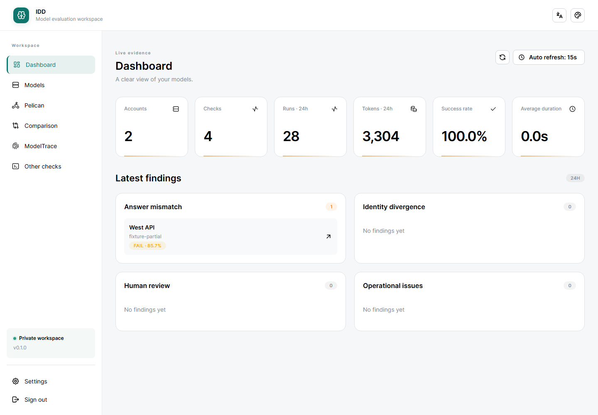
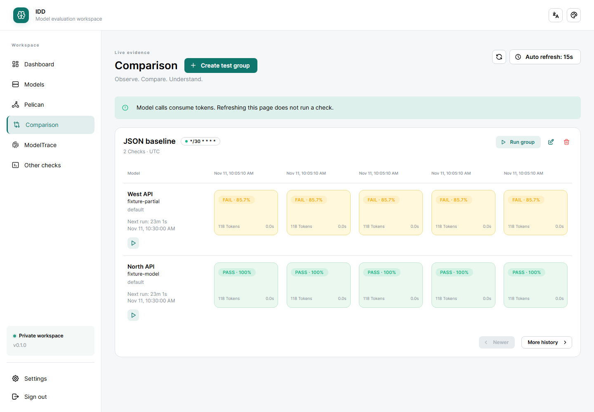
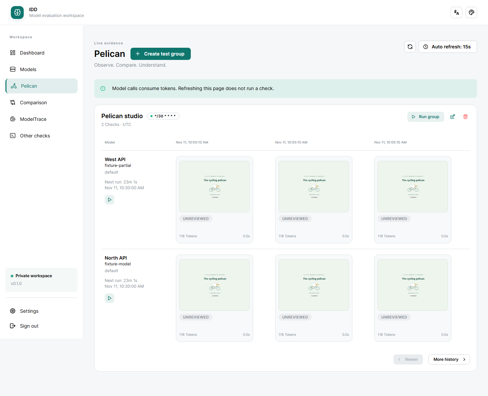
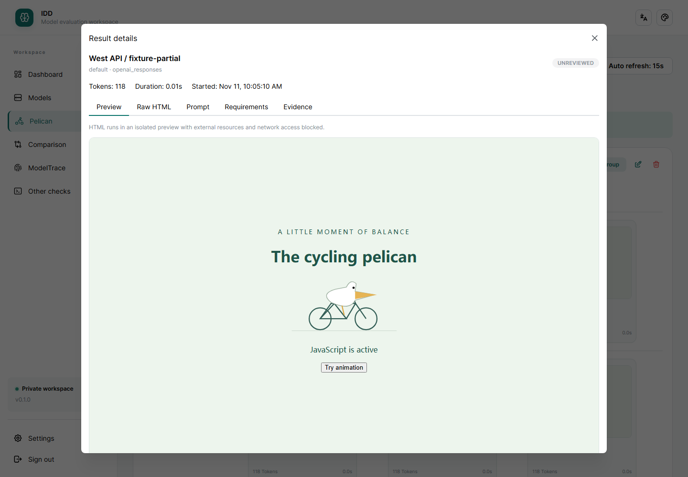

# Intelligence Degradation Detection

[English](README.md) · [简体中文](README.zh-CN.md)

A private model evaluation workspace for individuals and small teams. Send a prompt, retain the response and usage evidence, and compare results across accounts, models, and time. A task score or fingerprint is evidence about that test, not a universal intelligence measurement or proof of model identity.

- **Pelican:** compare self-contained HTML creations in isolated interactive previews.
- **Comparison:** recursively score JSON answers or apply bounded regular expressions.
- **ModelTrace:** run one to three fixed numeric challenges, inspect candidate probabilities, and open the upstream GitHub project from the page.
- **Other checks:** collect arbitrary answers and record human judgments.

Includes named test groups, cron schedules, cancellation, model catalogues, direct API accounts, read-only sub2api import/synchronization, a Dashboard, Chinese/English UI, responsive layouts, and customizable themes. Ordinary checks use one model call; ModelTrace uses one call per selected challenge. Calls consume provider tokens; page refresh never runs a check.

## Preview

These screenshots use **synthetic accounts, model identifiers, responses, and usage** from the local demo. They show the actual WebUI, not benchmark results or a production installation. No login token, API key, source connection, or proxy address is shown.



<details>
<summary>Comparison matrix and interactive HTML previews</summary>

**Comparison:** aligned execution batches with JSON scores and result details.



**Pelican:** scan HTML previews, then open an isolated interactive view.





</details>

## Deploy with Docker

Requires Docker Engine/Desktop with Docker Compose. Download or clone the project, then run from **the repository root containing `compose.yaml`**:

```sh
docker compose up --build -d
docker compose exec idd cat /app/resources/data/yaml/auth.yaml
```

Open **http://localhost:8000** and sign in with the file's `access_token`. Read it privately; do not share the file. The named volume preserves the token, accounts, and history across container recreation. The default port is bound to localhost. See [deployment](docs/deployment.md) for remote access, backups, and local development with Python 3.13 and Node 24.

Docker builds React/TypeScript and FastAPI into one image; SQLite and the scheduler run in one application process. No external database is required. Optional defaults are documented in [`.env.example`](.env.example). Use an HTTPS reverse proxy for remote access; [subpath deployment](docs/deployment.md#reverse-proxy-example) also supports a URL prefix such as `/evaluation/`.

Add an account under **Models**, choose its explicit protocol (OpenAI Responses, Anthropic Messages, or OpenAI Chat Completions), configure its request and catalogue paths, and refresh or manually enter a model. Create a test group, select accounts, review the prompt, and run it or enable its schedule. Read [usage and evaluation rules](docs/usage.md) before interpreting results.

Model fields reopen the full cached list and filter only while typing. Reasoning choices respect known model restrictions; incompatible saved choices require an explicit correction.

For sub2api accounts, configure **Settings → Source connection**, import accounts, then choose and save each account's default model. **Verify source route** refreshes the displayed proxy ID/address without a model call; **Probe connection** performs a metered call. See [source connection and proxy verification](docs/deployment.md#manual-sub2api-connection).

## Try the local demo

The included browser fixture starts the real WebUI with two fictional accounts, a JSON comparison, and Pelican history. Model calls and catalogue reads are simulated; account-source access is blocked. No provider credentials or paid inference are needed.

With **Python 3.13, Node 24, and uv**, run from the project directory:

```sh
uv sync --frozen --extra dev --python 3.13
cd src/web
npm ci
npm run build
cd ../..
uv run --frozen python tests/e2e_server.py
```

Open **http://127.0.0.1:8765** and use the public fixture token `browser-fixture-token-not-a-secret`. This is a **local-only development demo**, with temporary data reset on restart; it is not a production login credential. Stop with Ctrl+C. See [demo walkthrough](docs/demo.md) for the sample flows and limitations.

## Project and third-party code

Python source and the React app live in `src/`; documentation in `docs/`; maintained third-party snapshots in `threeparty/`; application data and built UI in `resources/`.

The fingerprint detector uses the MIT-licensed core and candidate bank from [ModelTrace](https://github.com/xqy2006/ModelTrace). Its pinned snapshot includes GPT and Claude families with 18 candidates. This application does not start the upstream frontend or services and does not update the snapshot automatically. See [third-party attribution and upgrade procedure](docs/third-party.md).

- [Usage, scoring, and scheduling](docs/usage.md)
- [Deployment and development](docs/deployment.md)
- [Local demo and screenshots](docs/demo.md)
- [ModelTrace attribution and upgrades](docs/third-party.md)
