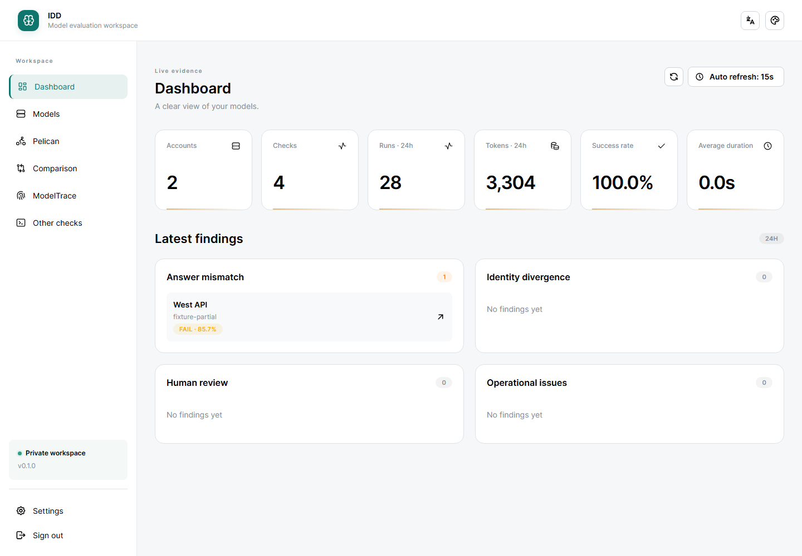
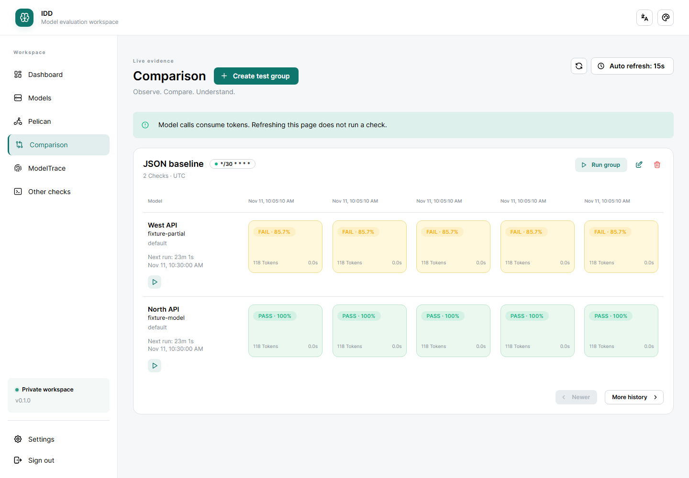
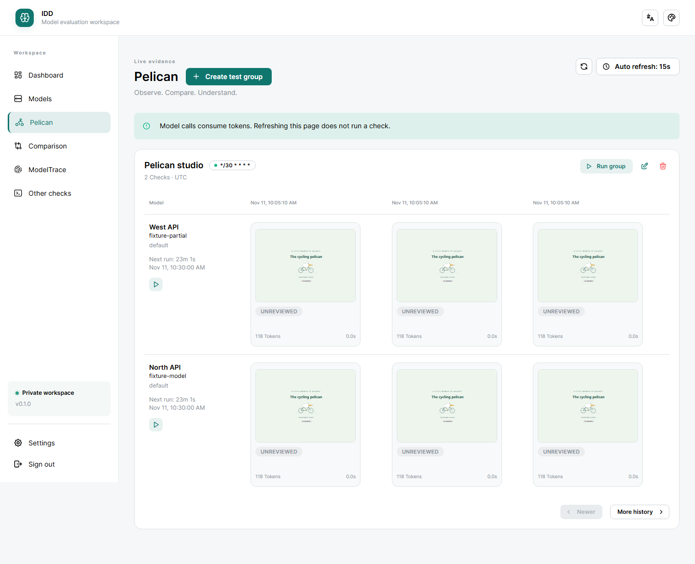
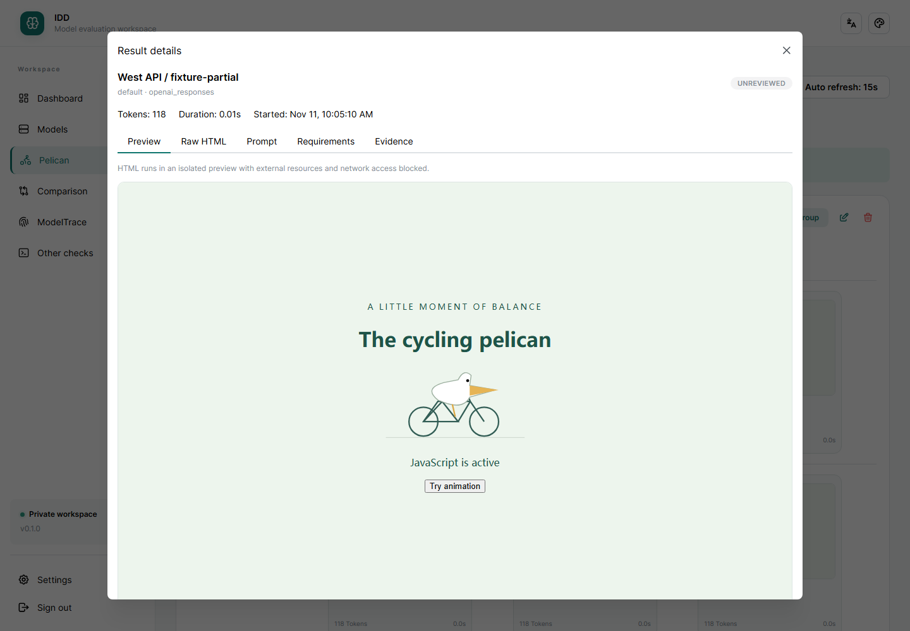

# Intelligence Degradation Detection

[English](README.md) · [简体中文](README.zh-CN.md)

面向个人和小团队的私有模型评估工作台。发送提示词，保存模型回答、用量和耗时，跨账号、模型与时间比较结果。任务得分和指纹只代表相应测试中的证据，不能直接视为普遍智力测量或真实模型身份的证明。

- **鹈鹕检测：**在隔离的交互式预览中比较模型生成的自包含 HTML 页面。
- **对比检测：**递归比对 JSON 答案，或使用有执行时限的正则表达式判定。
- **ModelTrace：**执行一至三项固定数字挑战，查看候选模型概率，并从页面快捷跳转至原 GitHub 项目。
- **其他检测：**保存任意回答并记录人工判定。

提供命名测试组、Cron 调度、取消、模型列表缓存、直接 API 账号、sub2api 只读导入和同步、Dashboard、中英文界面、响应式布局与自定义主题。普通检测每轮调用一次模型；ModelTrace 每项选中挑战调用一次。模型调用消耗上游 Token；页面刷新不会执行检测。

## 界面预览

以下截图来自本地演示，账号、模型标识、回答和用量均为**模拟数据**。展示的是真实 WebUI，不代表基准测试成绩或生产环境；画面不包含登录 Token、API Key、账号来源连接或代理地址。



<details>
<summary>查看对比矩阵与交互式 HTML 预览</summary>

**对比检测：**按执行批次排列，查看 JSON 正确率与结果详情。



**鹈鹕检测：**浏览历史 HTML 缩略图，点击后打开隔离的交互式预览。





</details>

## Docker 部署

需要安装带 Docker Compose 的 Docker Engine/Desktop。下载或克隆项目后，在**包含 `compose.yaml` 的仓库根目录**执行下列命令：

```sh
docker compose up --build -d
docker compose exec idd cat /app/resources/data/yaml/auth.yaml
```

打开 **http://localhost:8000**，使用文件中的 `access_token` 登录。请私下读取，不要分享该文件。命名卷保存令牌、账号和历史，重建容器不会丢失数据。默认端口仅绑定本机。远程访问、备份以及 Python 3.13、Node 24 本地开发方式见[部署文档](docs/deployment.md)。

Docker 将 React/TypeScript 前端与 FastAPI 后端构建为一个镜像，SQLite 与调度器使用单应用进程，无需外部数据库。可选配置见 [`.env.example`](.env.example)。远程访问应使用 HTTPS 反向代理；[子路径部署示例](docs/deployment.md#reverse-proxy-example)支持 `/evaluation/` 等 URL 前缀。

在**模型管理**添加账号，明确选择 OpenAI Responses、Anthropic Messages 或 OpenAI Chat Completions 协议，配置请求路径和模型列表路径，然后刷新或手动输入模型。新建测试组，选择账号、检查提示词，并立即执行或启用计划。解读结果前请阅读[使用和判定规则](docs/usage.md)。

模型输入框重新打开时展示完整缓存列表，仅在输入时筛选。推理选项遵守已知模型限制；已有的不兼容选项需显式修改。

账号和测试组卡片支持拖动排序并保存。连通性检测在后台运行，在账号卡片显示状态和耗时。账号可确认后从本地删除，历史结果仍保留，导入来源的原账号不受影响。详见[账号管理](docs/usage.md#accounts-and-test-groups)。

使用 sub2api 时，先配置**设置 → 账号来源连接**并导入账号，再为各账号选择并保存默认模型。**核对来源代理**重新读取并展示代理 ID 和地址，不调用模型；**检测连通性**会产生模型调用和用量。详见[来源连接和代理核对](docs/deployment.md#manual-sub2api-connection)。

## 本地 Demo

项目自带的浏览器测试环境使用真实 WebUI，预置两个虚构账号、JSON 对比和鹈鹕历史。模型调用与模型列表均为模拟，账号来源访问已禁用，无需模型凭据，也不会产生推理费用。

安装 **Python 3.13、Node 24 和 uv** 后，在项目目录运行：

```sh
uv sync --frozen --extra dev --python 3.13
cd src/web
npm ci
npm run build
cd ../..
uv run --frozen python tests/e2e_server.py
```

打开 **http://127.0.0.1:8765**，使用公开的测试令牌 `browser-fixture-token-not-a-secret`。此环境**仅用于本机开发演示**，临时数据重启后重置，令牌不能用于生产部署；按 Ctrl+C 停止。示例操作与限制见[演示说明](docs/demo.md)。

## 项目与第三方代码

Python 源码和 React 应用位于 `src/`；正式文档位于 `docs/`；维护的第三方快照位于 `threeparty/`；运行数据和构建后的页面位于 `resources/`。

指纹检测使用 MIT 许可的 [ModelTrace](https://github.com/xqy2006/ModelTrace) 核心和候选库。固定快照包含 GPT、Claude 两个家族共 18 个候选模型。本项目不启动其前端或其他服务，也不自动更新快照。详见[第三方署名和升级流程](docs/third-party.md)。

- [使用、评分和调度](docs/usage.md)
- [部署和开发](docs/deployment.md)
- [本地演示与截图](docs/demo.md)
- [ModelTrace 署名和升级](docs/third-party.md)
